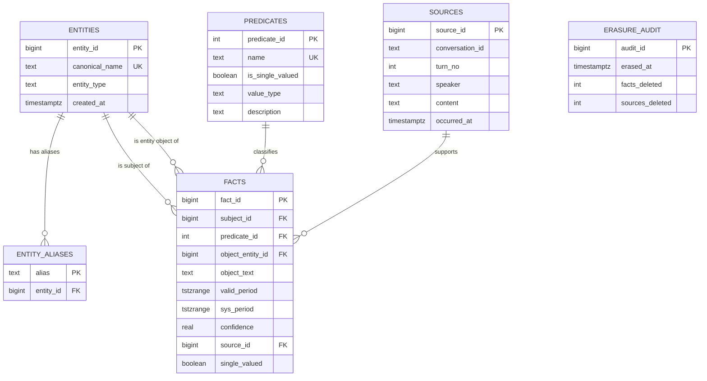

# Entity relationship diagram

## Relationship notes

- `facts.subject_id` identifies the entity making or having the statement.
- `facts.object_entity_id` is used when the object is another entity, such as
  an employer or city.
- `facts.object_text` is used for text values, such as a favorite food or job
  title.
- A fact has exactly one object representation: entity or text.
- `sources` preserve the original conversation evidence.
- `erasure_audit` is intentionally not connected to a user or entity, so it
  contains only aggregate deletion counts.
